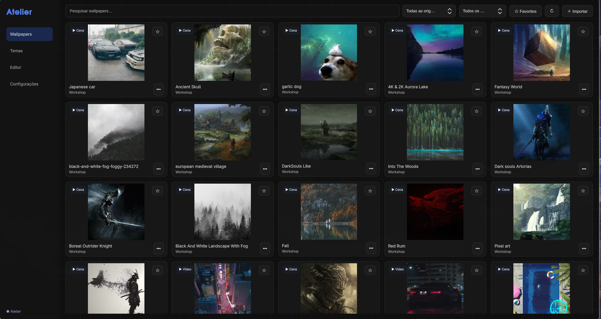

# # Atelier

**Um projeto pessoal para explorar a personalização do Omarchy.**

O Atelier surgiu da vontade de ter um lugar só para organizar meus wallpapers, explorar temas e personalizar as cores do sistema.

A ideia é criar uma alternativa mais visual e intuitiva aos gerenciadores tradicionais, com uma interface simples, sem abrir mão das opções de personalização.

## O projeto

O Atelier reúne algumas funcionalidades que eu queria ter no meu próprio desktop:

- **Wallpapers:** biblioteca visual com imagens locais e do Steam Workshop.
- **Temas:** visualização, edição e criação de paletas de cores.
- **Personalização:** cores extraídas dos wallpapers e configurações por monitor.
- **Interface:** navegação simples, pré-visualizações e foco no conteúdo.

## Tecnologias

Desenvolvido para o ambiente **Arch Linux + Omarchy**, utilizando:

- Python
- PySide6 / QML
- Hyprland e Quickshell
- FFmpeg
- linux-wallpaperengine

## Estado atual

**Em desenvolvimento — v0.3.0**

O Atelier já possui uma interface funcional e consegue acessar minha biblioteca de wallpapers e temas.

Algumas integrações com o desktop ainda estão sendo testadas e ajustadas. Por enquanto, o projeto foi desenvolvido para o meu ambiente pessoal e **não está preparado para instalação e uso geral em outros sistemas**.

O código está disponível principalmente para compartilhar o desenvolvimento e registrar minha evolução com Linux, interfaces gráficas e integração com o sistema.

## Próximos passos

- Finalizar e validar as integrações com o Omarchy.
- Melhorar o editor de temas.
- Refinar a experiência de uso.
- Tornar o projeto mais independente das configurações do meu ambiente.

---
